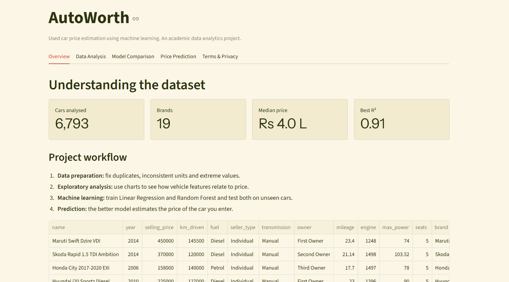
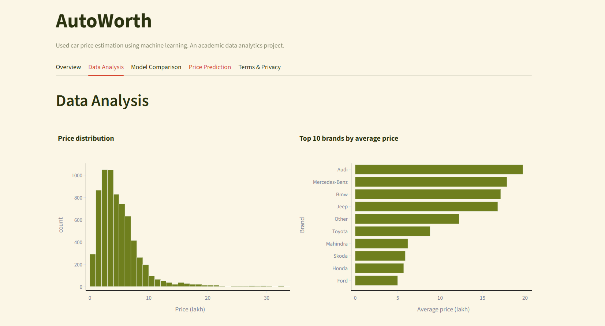
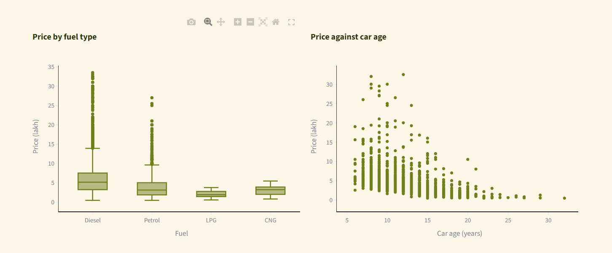
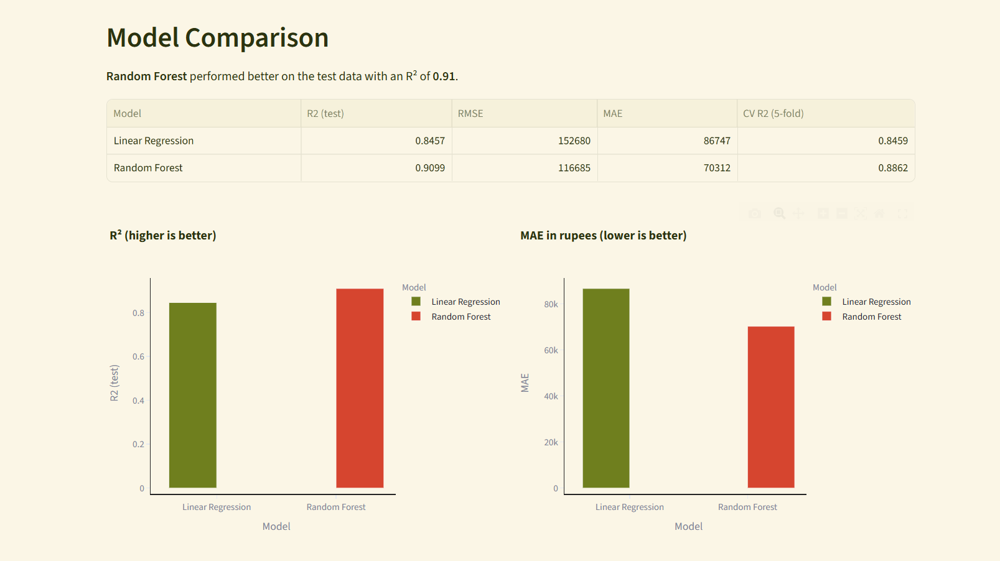
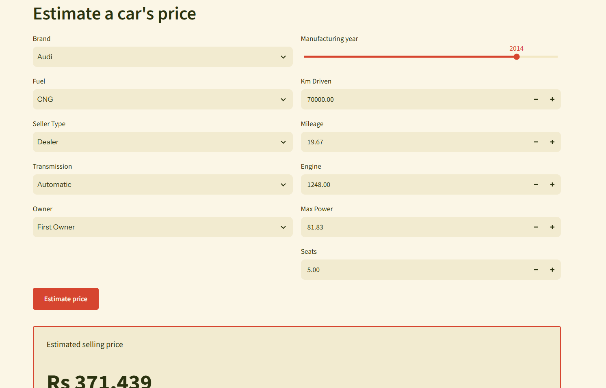

<div align="center">

# 🚗 AutoWorth

### Used Car Price Prediction

Estimate a used car's selling price with machine learning, through an interactive Streamlit app.

[](https://autoworth.streamlit.app)


</div>

---

## 📌 About

AutoWorth analyses 6,793 cleaned used-car listings, compares two regression models, and serves the best one through a five-tab web app. The **Random Forest** model explains about **91% of the variation in price** on unseen cars (R² 0.91, MAE about ₹70K).

> Built as a Data Analytics & Data Visualization (DAV) mini project at ANITS.

## ✨ Features

- 🧹 Full data pipeline: cleaning, feature engineering, EDA and visualization
- 🤖 Linear Regression and Random Forest compared on the same split and metrics
- 🔒 Leakage-safe scikit-learn pipeline (imputation, scaling and one-hot encoding fitted on training data only)
- 📊 Interactive Plotly charts and a model comparison tab
- 💰 Live price estimator with an expected range (prediction ± the model's MAE)

## 📸 Screenshots

## 📸 Screenshots

### Overview


### Data Analysis



### Model Comparison


### Price Prediction


## 📈 Results

| Model | R² (test) | RMSE (₹) | MAE (₹) | CV R² (5-fold) |
| --- | --- | --- | --- | --- |
| Linear Regression | 0.8457 | 152,680 | 86,747 | 0.8459 |
| **Random Forest** | **0.9099** | **116,685** | **70,312** | **0.8862** |

Random Forest's average error is about ₹70K, roughly 18% of the median car price (₹4 lakh).

**Key findings**
- Car age (about 0.51 importance) and max power (about 0.31) are the strongest price drivers.
- Premium brands (Audi, Mercedes-Benz, BMW, Jeep), diesel cars and automatic cars sell for more.
- Price correlates most strongly with max power (0.69) and negatively with car age (−0.51).

## 🗂️ Dataset

[Vehicle dataset from CarDekho](https://www.kaggle.com/datasets/nehalbirla/vehicle-dataset-from-cardekho) (Kaggle): 8,128 raw listings, cleaned to **6,793 rows** with 11 modelling features.

**Cleaning steps**
- Removed duplicates and rows without a price (1,202 rows)
- Converted text values with units (kmpl, CC, bhp) to numbers
- Dropped the mixed-unit torque column
- Created `brand` and `car_age`, and grouped brands with fewer than 20 cars as "Other"
- Trimmed extreme prices and distances (middle 99% kept)

The price is log-transformed during training because it is right-skewed.

## 🖥️ Web App Tabs

| Tab | What it shows |
| --- | --- |
| Overview | Key numbers, workflow and a preview of the cleaned data |
| Data Analysis | Price distribution, top brands, price by fuel type, price vs age |
| Model Comparison | Metrics table, R² and MAE charts |
| Price Prediction | Form for the car's details and an estimated price with range |
| Terms & Privacy | Academic-project notice; no personal data collected |

## ⚙️ Run Locally

```bash
git clone https://github.com/vasireddikeerthika/autoworth.git
cd autoworth
pip install -r requirements.txt
streamlit run app.py
```

Then open http://localhost:8501. Python 3.11 is recommended, since the saved model was trained with scikit-learn 1.6.1.

## 📁 Project Structure

```
autoworth/
├── .streamlit/config.toml  # App theme
├── app.py                  # Streamlit web app
├── car_price_model.joblib  # Saved model pipeline
├── cleaned_cars.csv        # Cleaned dataset
├── meta.json               # App metadata
├── model_metrics.csv       # Model comparison results
├── feature_importance.csv  # Random Forest feature importance
├── test_predictions.csv    # Actual vs predicted on the test set
├── screenshots/            # App screenshots
└── requirements.txt
```

## 🛠️ Tech Stack

Python · Pandas · NumPy · Matplotlib · Seaborn · scikit-learn · Joblib · Plotly · Streamlit

## ⚠️ Limitations

- The data is historical (cars up to 2020), so estimates for newer models may be unreliable.
- `mileage` and `max_power` contain 0.0 values that look like placeholders and could be treated as missing in a further cleaning pass.
- About 200 missing values in four columns are filled with simple median or most-frequent rules.
- Predictions are statistical estimates (average error about ₹70K), not official valuations.

## 🔮 Future Work

Gradient Boosting / XGBoost, hyperparameter tuning, a more recent dataset with features such as city and service history, better handling of zero values and torque.

## 👩‍💻 Author

**Vasireddi Keerthika Sai** · B.Tech CSE, ANITS

[](https://www.linkedin.com/in/vasireddi-keerthika)
[](https://github.com/vasireddikeerthika)
